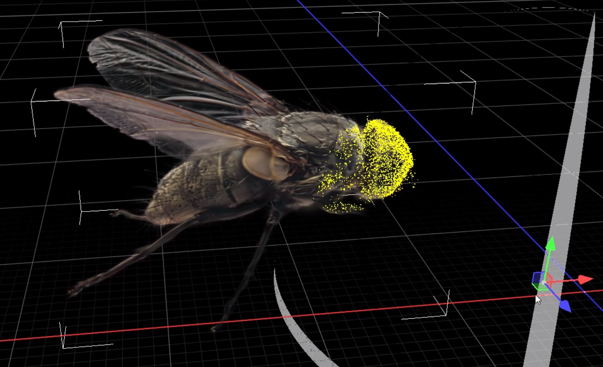
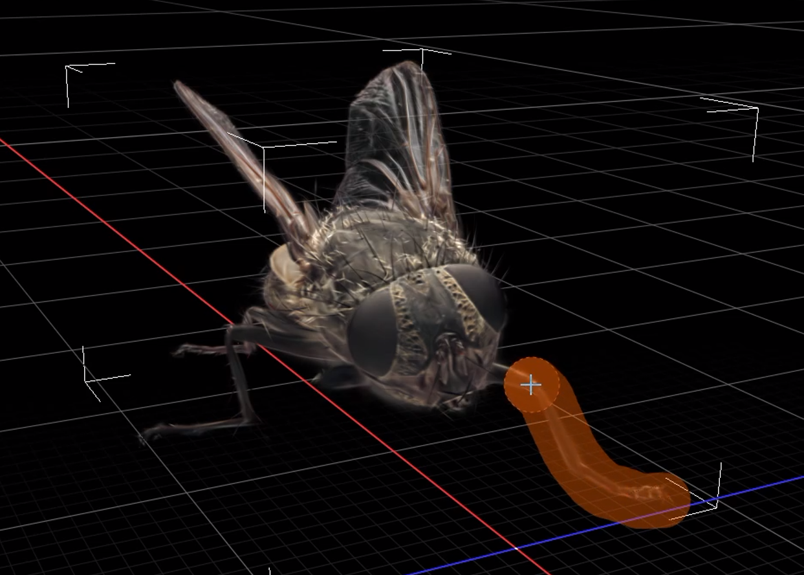

# Week 1 — Person 1: selecting known Gaussians in the editor

## 1. Summary

The editor already supports selecting an arbitrary set of Gaussians without any
code changes:

```js
// browser DevTools console, PLY loaded and its layer selected
scene.events.fire('select.mask', 'set', mask);
```

`select.mask` ([editor.ts](../../apps/editor/src/editor.ts), search
`'select.mask'`) wraps the selection in a `SelectOp` and adds it to the edit
history, so the result is highlighted, can be moved with the normal transform
gizmo, and is undoable with Ctrl+Z. `mask` can be either of the two formats
described below.

## 2. How `SelectOp` works

`SelectOp` ([edit-ops.ts](../../apps/editor/src/edit-ops.ts)) is the undoable
edit that changes the *selected* state of individual Gaussians:

```ts
new SelectOp(splat, op, sel)
//   splat — the layer (one loaded PLY)
//   op    — 'add' | 'remove' | 'set' | 'intersect'
//   sel   — the Gaussians that were "hit": Uint8Array mask or sorted Uint32Array of indices
```

| `op` | Effect on the current selection |
|---|---|
| `add` | Hit Gaussians become selected; existing selection is kept. |
| `remove` | Hit Gaussians become unselected. |
| `set` | Selection becomes exactly the hit set. |
| `intersect` | Only Gaussians that are both selected *and* hit stay selected. |

Internally the constructor:

1. turns `sel` into one function `isHit(i)` ("is Gaussian `i` hit?"),
   regardless of which format was passed;
2. picks a predicate per `op` (the `preds` object) that answers *"does Gaussian
   `i`'s selected bit need to change?"*;
3. scans all Gaussians once with `IndexRanges.fromPredicate(count, preds[op])`,
   collecting only the indices that actually change, stored compactly as runs;
4. pairs that with a bit operation per `op` (`bitOps`: SET, CLEAR or TOGGLE).
   `set` toggles exactly the Gaussians where "is selected" and "is hit"
   disagree.

Only *valid* Gaussians (unselected or selected) are touched; hidden, locked and
deleted Gaussians are skipped. Because only changed indices are recorded, undo
restores the exact previous selection.

## 3. The two formats of `sel`

### `Uint8Array` — a mask with one byte per Gaussian

- Length equals the number of Gaussians in the layer.
- Per Gaussian, the array contains **`255` if that Gaussian was hit**, or any
  other value if not.
- The check is exactly `sel[i] === 255`. A mask using `1` for "hit" (e.g. a NumPy
  boolean mask) selects **nothing**, silently. Convert first:
  `mask[i] = data[i] ? 255 : 0`.
- 255 is the convention of the GPU selection passes (rectangle, brush, sphere,
  property range, colour match), which write one byte per Gaussian.
- Cost: one byte per Gaussian regardless of how many are hit.

### `Uint32Array` — a sorted list of hit indices

- Contains only the hit Gaussian indices, in **ascending order, without
  duplicates**, e.g. `[12, 13, 14, 9001]`.
- `sortedPredicate(sel)` ([index-ranges.ts](../../apps/editor/src/index-ranges.ts))
  *returns a function*. Calling `isHit(<gaussian index>)` tells whether that
  Gaussian index is inside `sel`.
- The returned function remembers a private `cursor` into `sel` (a closure). It
  must be called with increasing indices `0, 1, 2, …`, which is how
  `fromPredicate` calls it.
- Together with `fromPredicate` it works like a **two-pointer merge**:
  - one pointer (`fromPredicate`'s loop) goes over every Gaussian index;
  - the other (`cursor`) goes over the indices in `sel` and only advances when
    the current Gaussian index matches.
  This needs a single pass and no lookup table.
- Cost: four bytes per *selected* Gaussian, which is smaller than the mask for
  small objects in large scenes.

**Pitfall (found by reading the code, not yet reproduced):** the predicates in
`SelectOp` short-circuit (`valid(i) && isHit(i) && …`), so `isHit(i)` is not
called for hidden, locked or deleted Gaussians, or, for `intersect`, for
unselected ones. If such an index is in `sel`, the cursor stays on it and
**every later index in `sel` is silently ignored**. For externally produced
object masks, prefer the `Uint8Array` format, which has no cursor.

## 4. Grouping Gaussians with `object_id.npy`

Segmentation methods assign every Gaussian to an object. The result is stored as
one number per Gaussian ([DATA_FORMAT.md](../DATA_FORMAT.md)):

```text
object_id.npy    dtype: uint16    shape: [N]   (N = Gaussian count of the source PLY)

Gaussian index:  0   1   2   3   4   5   6   7  ...
object_id:       0   0   7   7   0   3   7   0  ...
```

- **Array position `i` is Gaussian `i` of the source PLY.** The file stores no
  positions or colours; it relies on the Gaussian order. The manifest binds it to
  the PLY via checksum and Gaussian count.
- Values: `0` background, `1..65533` movable objects, `65534` ambiguous boundary,
  `65535` unknown/noise. Names for the IDs live in the manifest's `objects` list.
- A *group* (object) is simply all Gaussians with the same ID. Selecting object
  `7` in the editor means building a mask from the labels and applying it:

  ```js
  const mask = new Uint8Array(labels.length);
  for (let i = 0; i < labels.length; i++) mask[i] = labels[i] === 7 ? 255 : 0;
  scene.events.fire('select.mask', 'set', mask);
  ```

- A Week-1 binary mask from SAGA or Gaussian Grouping is the same idea with only
  two values (in / not in the object).

**Open question for the team:** this only works if the editor keeps the PLY's
Gaussian order on import. Check visually: if the selected region looks like the
object, the order is preserved; a random scatter means it is not. Also check
`labels.length === ` the PLY's Gaussian count before trusting a result.

##  Selecting Gaussians on a Scene in SuperSplat
Gaussians can be selected in various forms (all located on the lower bar)




- Sphere/Box selection: allows to create the shape, and all gaussians that lie inside it, can be selected
- Brush: for selection of irregular shapes